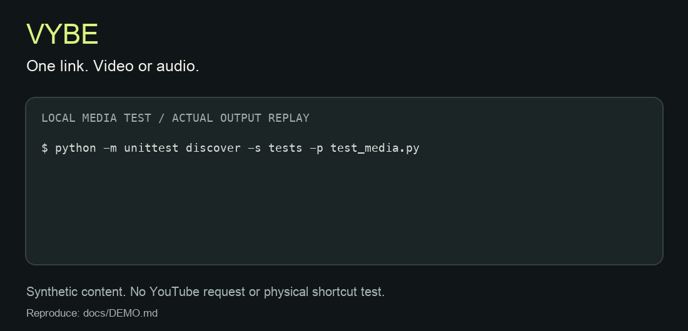

# VYBE

### Copy the link. Press the shortcut. Keep the moment.

[](https://github.com/mickfive05/VYBE/actions/workflows/tests.yml)
[](pyproject.toml)
[](docs/VERIFICATION.md)

VYBE turns the YouTube link on your clipboard into an MP4 video or MP3 audio file. Two global shortcuts. No application window. A focused local utility that stays out of your way.

Built with **yt-dlp and FFmpeg**, targeting Windows, macOS, and Linux desktops.

**Early preview:** synthetic media conversion is tested. Real YouTube downloads and physical desktop shortcuts still need verification. [See the evidence and limits](docs/VERIFICATION.md).



*Desktop recording supplied by the author, converted to a looping GIF. Copy a link, then press Ctrl + Alt + V for MP4 or Ctrl + Alt + A for MP3 (Control + Option on macOS). The MP3 scene contains a typo in its Mac overlay: use **A**, not V. [Demo details](docs/DEMO.md).*

[Installation](docs/INSTALL.md) · [Report a bug](https://github.com/mickfive05/VYBE/issues/new/choose) · [Help verify your desktop](CONTRIBUTING.md) · [Releases](https://github.com/mickfive05/VYBE/releases)

| Shortcut | Result |
| --- | --- |
| **Ctrl + Alt + V** | MP4 video |
| **Ctrl + Alt + A** | MP3 audio |

Files land in `~/Downloads/VYBE`, named with the video title and ID. Shortcuts and destination are configurable. On macOS, Ctrl means Control; Command can be configured instead.

## Your next download, without the detour

- **Video or audio, one gesture away.** Save an MP4 or extract high-quality variable-bitrate MP3 audio.
- **No GUI to manage.** A local listener with a CLI for direct downloads and native desktop shortcuts.
- **Predictable by design.** One download at a time, single-video URLs, no overwrites, resumable partial files, and clear errors.
- **Your machine, your files.** VYBE adds no account, cloud relay, analytics, or tracking service.
- **Agent-ready.** A bundled ChatGPT/Codex skill helps install, configure, diagnose, and use VYBE where local execution is available.

## Get started

Prerequisites: **Python 3.10+**, **FFmpeg including ffprobe**, and **Deno** on PATH. Python dependencies include yt-dlp's default extras. Follow the [platform installation guide](docs/INSTALL.md) for prerequisite commands and permissions.

```sh
git clone https://github.com/mickfive05/VYBE.git
cd VYBE
python3 -m venv .venv
.venv/bin/python -m pip install .
.venv/bin/vybe doctor
.venv/bin/vybe run
```

On Windows use `py -3` instead of `python3`, and `.venv\Scripts\python.exe` / `.venv\Scripts\vybe.exe` instead of `.venv/bin/...`.

Keep the listener running, copy a YouTube video URL, then press either shortcut. Stop with Ctrl+C. For invisible background operation and optional login startup, see [installation](docs/INSTALL.md#background-operation-and-login-startup).

```sh
vybe download mp4                          # read the clipboard
vybe download mp3 --url 'https://youtu.be/BaW_jenozKc'
vybe download mp4 --output '/path/to/videos'
```

Commands using `vybe` assume the virtual environment is activated or its executable directory is on PATH.

## Make it yours

Create `config.json` in the [VYBE data directory](docs/INSTALL.md#configuration-and-logs), or use `vybe --config /path/to/config.json run`:

```json
{
  "output": "~/Downloads/VYBE",
  "mp4_hotkey": "<ctrl>+<alt>+v",
  "mp3_hotkey": "<ctrl>+<alt>+a"
}
```

On macOS, `<cmd>+<alt>+v` and `<cmd>+<alt>+a` are alternatives. Choose combinations that do not conflict with other applications, then restart the listener.

## Platform support

| Desktop | Integration |
| --- | --- |
| Windows | Global shortcuts in an interactive user session |
| macOS | Global shortcuts; Accessibility/Input Monitoring permissions may be required |
| Linux / X11 | Global shortcuts; X display and clipboard provider required |
| Linux / Wayland | Bind `vybe download mp4` and `vybe download mp3` to native desktop shortcuts; listener mode refuses Wayland |

These are target platforms. Automated tests do not prove physical keyboard or permission behavior on every desktop. See [actual verification results](docs/VERIFICATION.md).

## ChatGPT / Codex skill

The distributable skill is [`skills/vybe`](skills/vybe/SKILL.md), including `SKILL.md` and `agents/openai.yaml`. For Codex, copy that folder to `~/.codex/skills/vybe` and refresh skill discovery. In other ChatGPT environments, use their supported skill import mechanism if available. A remote chat session cannot read your desktop clipboard or register local shortcuts by itself.

## Details that matter

MP4 mode selects MP4 video and M4A audio and merges with FFmpeg. It fails if compatible formats are unavailable; it does not silently return WebM or promise a specific resolution or codec. MP3 conversion cannot improve source quality. Playlists are ignored. A live stream can continue until its broadcast ends or VYBE is stopped.

YouTube can change extraction requirements or restrict videos. Update dependencies before troubleshooting site errors. VYBE does not bypass DRM, sign-in restrictions, or access controls. Download content you own or have permission to save, following applicable service terms.

## Develop

```sh
python -m pip install -e .
python -m unittest discover -s tests -v
```

CI is configured for Windows, macOS, and Linux with Python 3.10 and 3.13. [Verification](docs/VERIFICATION.md) distinguishes local results from pending CI and desktop checks. No standalone installers or bundled FFmpeg/Deno binaries are included.

## Help shape VYBE

The most useful feedback is a real installation report. Follow [CONTRIBUTING.md](CONTRIBUTING.md), then open a desktop verification issue with your OS, session type, results for both formats, and any permission or setup steps. Mark checks you did not run as untested.

Have a reproducible failure or a workflow idea? Use the [issue forms](https://github.com/mickfive05/VYBE/issues/new/choose). Review logs before posting; remove private links, tokens, cookies, and personal paths.

## Rights and permissions

**All rights reserved.** The source is publicly visible for review; VYBE is not currently offered under an open-source license. See [LICENSE](LICENSE) and contact the maintainer through GitHub for permissions. Third-party components retain their own licenses. Discuss contribution terms before submitting code.
